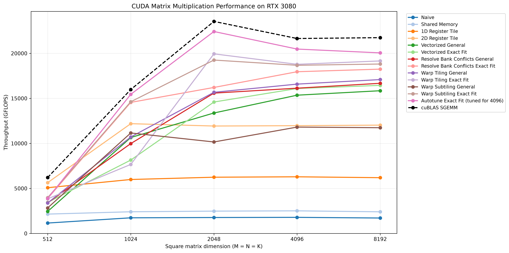

# CUDA Matrix Multiplication Optimization

This project explores how to optimize single precision (FP32) matrix multiplication in CUDA, progressing from a naive kernel to an autotuned implementation. It demonstrates how memory access patterns, data reuse, and the distribution of work across threads affect GPU performance.

The repository includes a full tutorial explaining each optimization step, CUDA kernels, a Python autotuner, benchmarks against cuBLAS SGEMM on an RTX 3080, and Nsight Compute profiling results.

[Read the full tutorial](cuda_matrix_multiplication_tutorial.md)

## Performance

For `C = A × B`, matrix `A` has dimensions `M x K`, matrix `B` has dimensions `K x N`, and the output `C` has dimensions `M x N`.

Here, `M` is the output row count, `N` is the output column count, and `K` is the shared dimension over which products are summed.

For `M = N = K = 4096`, the autotuned FP32 kernel achieves **94.6% of cuBLAS SGEMM performance**, measured by throughput, on an NVIDIA RTX 3080. It is approximately **11.46x faster than the naive kernel**.

| Implementation | Average Duration | Throughput |
|---|---:|---:|
| Autotuned CUDA kernel | 6.712 ms | 20.48 TFLOPS |
| cuBLAS SGEMM | 6.349 ms | 21.65 TFLOPS |

The following plot compares all implementations across five matrix sizes. The autotuned kernel uses the configuration selected for 4096 x 4096 at every tested size.



See [Benchmark results and profiling](cuda_matrix_multiplication_tutorial.md#benchmarks) for the measurement setup, complete benchmark results, and Nsight Compute analysis.


## Optimizations

The project progresses through the following stages:

1. **[Global memory coalescing](cuda_matrix_multiplication_tutorial.md#optimization-1-global-memory-coalescing)** — arrange thread accesses to use memory transactions efficiently.
2. **[Shared memory tiling](cuda_matrix_multiplication_tutorial.md#optimization-2-shared-memory)** — reuse input values across threads within a block.
3. **[1D register tiling](cuda_matrix_multiplication_tutorial.md#optimization-3-1d-register-tiling)** — compute multiple output values per thread.
4. **[2D register tiling](cuda_matrix_multiplication_tutorial.md#optimization-4-2d-register-tiling)** — reuse register values across a two-dimensional output tile.
5. **[Vectorized memory accesses](cuda_matrix_multiplication_tutorial.md#optimization-5-vectorization)** — load and store values using `float4`.
6. **[Shared memory bank conflict resolution](cuda_matrix_multiplication_tutorial.md#optimization-6-resolving-bank-conflicts)** — map logical coordinates to physical layouts that avoid conflicts.
7. **[Warp tiling](cuda_matrix_multiplication_tutorial.md#optimization-7-warp-tiling)** — organize output tiles around individual warps.
8. **[Warp subtiling](cuda_matrix_multiplication_tutorial.md#optimization-8-warp-subtiling)** — divide each warp tile into smaller tiles for additional layout flexibility.
9. **[Autotuning](cuda_matrix_multiplication_tutorial.md#optimization-9-autotuning)** — search tile sizes, thread layouts, loop unrolling, and shared memory mappings.

Several stages include both general kernels that handle incomplete tiles and exact fit kernels that require complete tiles.

## Repository Structure

```text
.
├── src/
│   ├── cuda/       # CUDA kernels and cuBLAS implementation
│   ├── cpu/        # CPU matrix multiplication implementation
│   └── main.cpp    # Benchmark entry point
├── include/        # Headers and benchmark templates
├── autotune/       # Autotuner, CUDA kernel template, and benchmark runner
├── benchmarks/
│   ├── results/    # Benchmark outputs for each matrix size
│   ├── autotune/   # Autotune rankings and Nsight Compute output
│   └── plots/      # Benchmark charts
├── scripts/        # Benchmark plotting script
├── cuda_matrix_multiplication_tutorial.md
├── README.md
├── Makefile
└── requirements.txt
```

The `build/` directory is generated at the repository root and contains the compiled benchmark executable, generated kernels, object files, and autotuner executables.

## Building and Running

### Requirements

- An NVIDIA GPU and the CUDA Toolkit, including `nvcc`, cuBLAS, and cuRAND.
- Make and a host compiler that supports C++20.
- Python 3 for autotuning and plotting.
- Matplotlib for plotting.

> **Note:** The project targets `sm_86` for the RTX 3080. For a different GPU architecture, update the architecture flags in `Makefile` and `autotune/compiler.py`.

### Running the Benchmarks

Run the following commands from the repository root.

```bash
make run
```

This builds `build/matmul` and benchmarks each implementation, validating its output against the reference implementation.

The default dimensions are `M = N = K = 4096`. To test another size, edit `M`, `N`, and `K` in `src/main.cpp` and rebuild. Dimensions must satisfy the tile requirements of the exact fit kernels being benchmarked. To run only the general kernels, remove or comment out the exact fit benchmark calls in `src/main.cpp`.

### Running the Autotuner

```bash
python -m autotune.main
```

Set the matrix dimensions and number of kernels to retain in `autotune/main.py`. Sweep values, worker counts, and batch size are configured in `autotune/tuner.py`.

The tuner saves rankings to `build/generated/results/` and retains the best generated kernels in `build/generated/kernels/`. The full sweep can take several hours.

### Generating the Benchmark Plot

```bash
python -m pip install -r requirements.txt
python scripts/plot_benchmarks.py
```

The script reads the benchmark outputs in `benchmarks/results/` and saves the chart to `benchmarks/plots/`.

## Future Work

- Explore prefetching, double buffering, and asynchronous copies to overlap data loading with computation.
- Implement Tensor Core kernels and evaluate their throughput and numerical precision.
